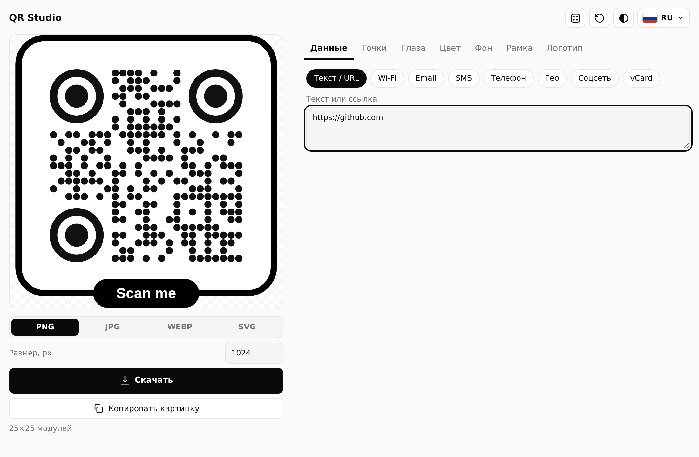
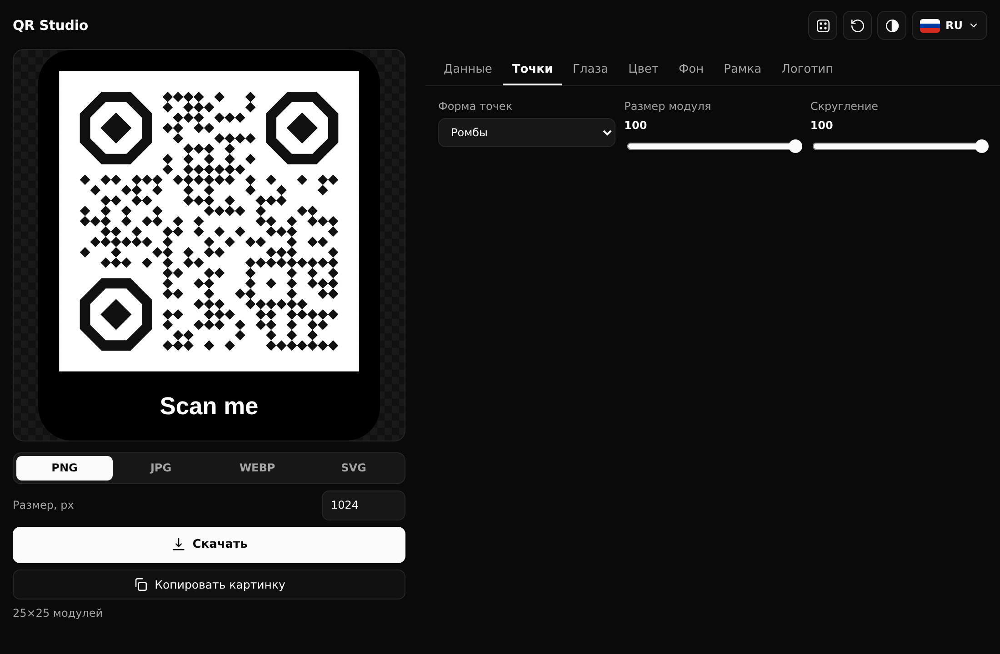
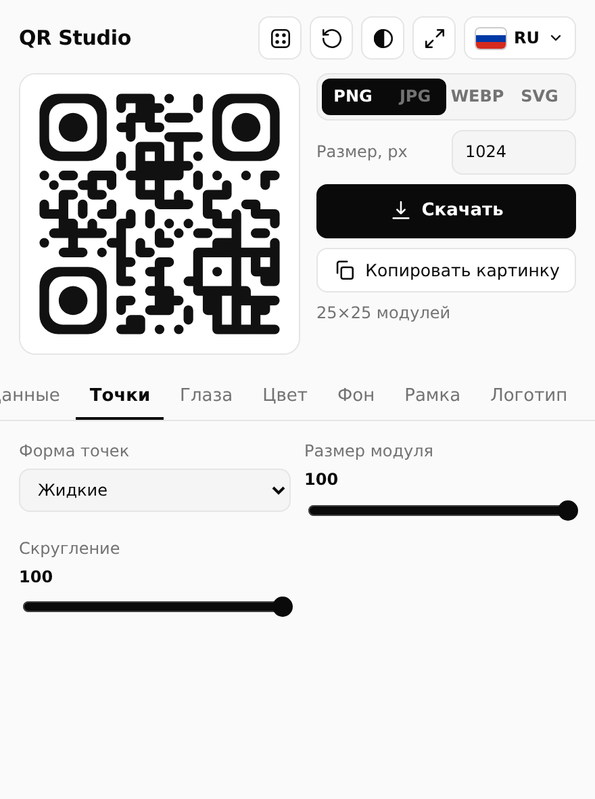

# QR Studio

**Минималистичный генератор QR-кодов для Chrome.** Формы точек и глаз, рамки с подписью, градиенты, логотип в центре (в том числе из точек), экспорт в PNG, JPG, WEBP и SVG. Работает полностью офлайн.

[English](README.en.md) · [Публикация и безопасность](PUBLISHING.md)

   

  
  

## Возможности

**Данные**
- Текст и ссылки, Wi‑Fi, Email, SMS, телефон, геопозиция, vCard
- Соцсети: Telegram, WhatsApp, Instagram, YouTube, TikTok, GitHub
- Кнопка «Текущая вкладка» подставляет адрес открытой страницы

**Внешний вид**
- 9 форм точек: квадраты, жидкие, мягкие квадраты, точки, классика, ромбы, кресты, линии (горизонтальные и вертикальные), плюс размер модуля и скругление
- 7 форм рамки и 7 форм центра «глаз» (квадрат, скруглённый, круг, лист, зеркальный лист, восьмиугольник, ромб) с отдельными цветами
- Сплошная, линейная и радиальная заливка, 7 готовых палитр, кнопка случайного стиля
- Цвет фона, прозрачный фон, скругление фона, поля, уровни коррекции L / M / Q / H

**Рамки.** 8 стилей с подписью: плашка снизу и сверху, тонкая и двойная линия, пунктир, угловые скобки, бейдж, объёмная тень.

**Логотип**
- Загрузите картинку (PNG, JPG, WEBP, SVG до 5 МБ), и точки QR **обтекают её контур**, а не вырезают квадрат. Есть и режим квадратной вырезки
- Превращение логотипа в точки: ромбы, квадраты, круги или стиль самого QR, детализация, порог, свой цвет или цвета оригинала
- С логотипом коррекция ошибок автоматически ставится на H, а интерфейс показывает, сколько точек скрыто

**Экспорт и удобство**
- Скачать PNG / JPG / WEBP / SVG до 4096 px, копировать картинку в буфер
- Проверка сканирования встроенным детектором Chrome (где он доступен)
- Светлая и тёмная тема, сброс настроек, большое окно, настройки запоминаются
- Интерфейс на русском, польском, украинском и английском

## Установка

Из исходников, сборка не нужна:

1. Скачайте репозиторий (`Code` → `Download ZIP`) и распакуйте.
2. Откройте `chrome://extensions` и включите «Режим разработчика».
3. Нажмите «Загрузить распакованное» и выберите папку проекта (где лежит `manifest.json`).
4. Закрепите иконку QR Studio на панели браузера.

Чтобы просто посмотреть интерфейс, откройте `popup.html` в браузере.

## Приватность и безопасность

- Все данные обрабатываются локально, расширение не делает сетевых запросов (`connect-src 'none'`), без аналитики и удалённого кода
- Содержимое QR-кода (пароли, контакты) нигде не сохраняется. В хранилище лежат только настройки внешнего вида
- Строгая CSP без `unsafe-inline` и `unsafe-eval`, минимум прав: `activeTab`, `clipboardWrite` и необязательное `tabs`
- Логотип проверяется по типу и размеру и перерисовывается в PNG, поэтому скрипты из SVG не выполняются

Подробности: [PUBLISHING.md](PUBLISHING.md), [PRIVACY.md](PRIVACY.md).

## Структура

| Файл | Назначение |
|---|---|
| `manifest.json` | Манифест MV3, CSP, права |
| `popup.html`, `popup.css` | Интерфейс |
| `popup.js` | Генерация SVG, рамки, логотип, экспорт, переводы |
| `qr-lib.js` | Кодирование QR (см. лицензию ниже) |
| `_locales/` | Название и описание расширения на 4 языках |
| `icons/` | Иконки |

Чтобы изменить название или описание в Chrome, правьте `_locales/*/messages.json`, затем нажмите ↻ на `chrome://extensions`.

## Разработка

Сборки нет: обычные HTML, CSS и JavaScript. Изменили файл — обновите расширение на `chrome://extensions`. Новый язык добавляется в таблицу `TR` в начале `popup.js` (формат `ru|pl|uk|en`) и в список `LG`.

## Лицензии

Кодирование QR выполняет «QRCode for JavaScript» Казухико Арасэ (MIT), текст лицензии в [THIRD_PARTY_LICENSES.txt](THIRD_PARTY_LICENSES.txt). «QR Code» — зарегистрированный товарный знак DENSO WAVE INCORPORATED.
